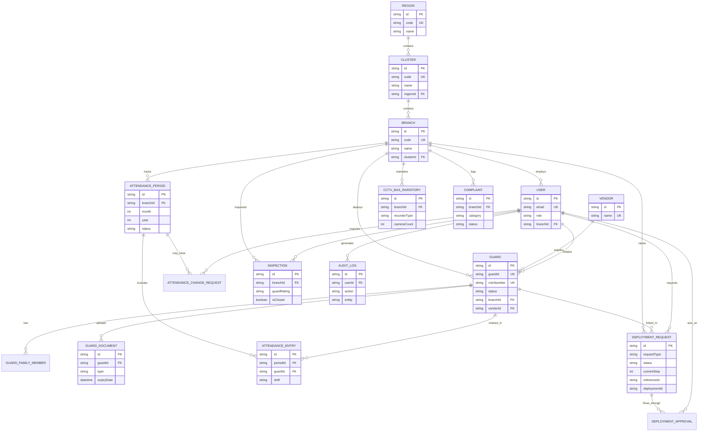

# Entity Relationship Diagram (ERD)
## Security Management System

Use this diagram for training, BA walkthroughs, and DB onboarding.

## Training reading order

1. Org hierarchy: Region → Cluster → Branch  
2. Master data: Vendor + Guard + Documents  
3. Monthly ops: AttendancePeriod → Entries → ChangeRequest  
4. Workflow: DeploymentRequest → Approvals  
5. Risk modules: Inspection, CCTV/BAS, Complaint  
6. Control plane: User/RBAC, SystemConfig, AuditLog, Notification  
